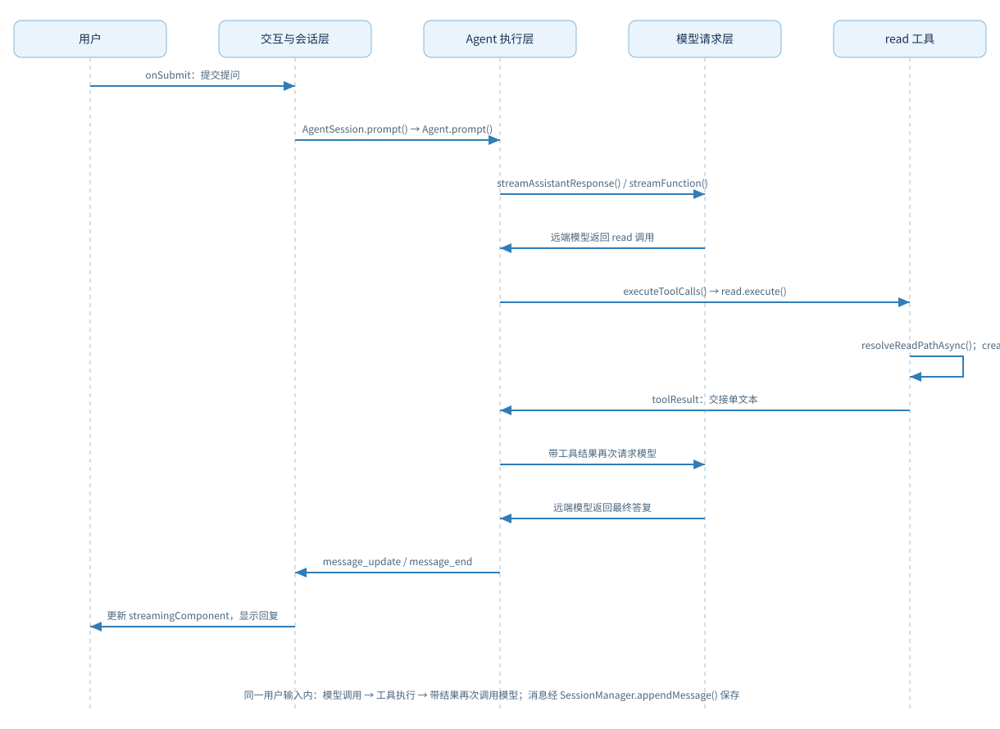
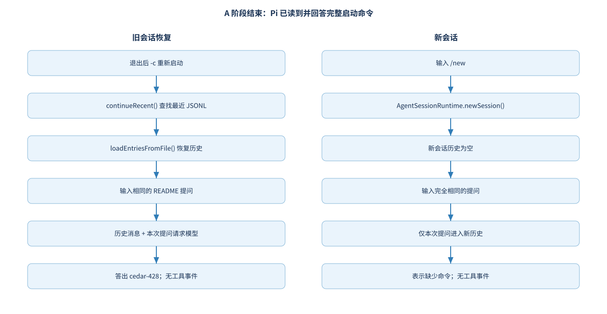

# 实践课 5：Pi Agent 源码泛读与功能定位

- 姓名：阳凌杰
- 小组仓库：[superheror/pi-hunnu-2026](https://github.com/superheror/pi-hunnu-2026)
- 本地实验目录：`D:\study\开源\pi-hunnu-2026`
- 实验所用基础提交：`c3cc91632d0a1950fb122605b190233f2aa0006e`；沿用实践课 4 的两条本地观察日志，本次未修改源码。

## 一、实验目的

按[教师作业要求](https://github.com/hunnuOpenSourceSoftware2026/assignments/blob/main/practice/05-Pi-Agent-source-reading.md)，从实际的 `read` 工具调用追踪 Pi Agent 的输入、模型请求、工具执行和回复显示流程；再比较恢复旧会话与新建会话时模型可获得的历史消息。报告提交两张图、实验截图和源码依据。教师指定的报告文件名是 `practive-05.md`，此处保留原拼写。

## 二、环境与证据

- 实验所用 Pi 源码：`D:\study\开源\pi-hunnu-2026`，核对时 HEAD 为 `c3cc91632d0a1950fb122605b190233f2aa0006e`。本报告引用这一工作树的当前源码，其中 `packages/agent/src/agent-loop.ts` 有实践 04 留下的两条 `[P4]` 日志改动；源码仓库本身未作修改。
- 作业目录：`D:\study\开源\Pi-Agent-Practice-5`。实验实际在 Pi 源码目录中运行；`handoff.txt` 位于该目录。
- 模型与思考等级：`deepseek-v4-pro`、`high`（截图可见）。以下“未调用工具”指截图与实验观察中未出现工具事件，不能单独证明模型内部状态。

| 阶段 | 观察结果 | 原始截图 |
|---|---|
| A：读取交接单 | `read` 读取 `D:/study/开源/pi-hunnu-2026/handoff.txt`；回复包含“补充 README 的启动说明”和 `npm run demo -- --profile cedar-428`；底部可见实践 04 两条日志。 | [S1.png](S1.png) |
| B：恢复旧会话 | 退出后以 `node .\packages\coding-agent\dist\cli.js -c` 启动；同一提问、不调用工具，回答给出完整命令。截图展示回答，未同时展示启动命令及恢复聊天列表；这两项根据实验操作记录。 | [S2.png](S2.png) |
| B：新会话 | `/new` 后相同提问、同模型，明确称缺少交接单内容和命令；截图可见“New session started”。 | [S3.png](S3.png) |

两次 B 阶段的完整提问均为：“接着上次的待办，给 README 起草一条启动说明，写出交接单里的完整启动命令。只用这次会话已有的信息。不要调用工具。如果缺少命令，请直接说明。”旧会话回答正确且未重新读取文件，支持它使用了恢复的会话历史；新会话不含 A 的历史，因而不能给出命令。这里没有声称实际修改了 README；要求是起草说明。

## 三、图 1：A 阶段单轮工具调用的代码级时序

可编辑源文件：[figure1.mmd](figure1.mmd)。五条生命线按职责合并对象。一次用户输入中有两次模型请求：首次返回工具调用，`read` 返回结果后再次请求模型形成最终答复。

关键调用路径（行号对应上述工作树）：

1. `packages/coding-agent/src/modes/interactive/interactive-mode.ts:3325` 的编辑器 `onSubmit` 接收文本；普通输入在 `3512–3521` 通过 `onInputCallback` 送入输入队列。交互运行循环调用 `this.session.prompt(...)`（同文件 `1296`）。
2. `packages/coding-agent/src/core/agent-session.ts:2175–2208` 的 `AgentSession.prompt()` 执行 `_preparePrompt()`、`_startRun()`；`1982` 调用 `this.agent.prompt(messages)`。
3. `packages/agent/src/agent.ts:382–389` 的 `Agent.prompt()` 转到 `runPromptMessages()`；`441–453` 调用 `runAgentLoop()`。`packages/agent/src/agent-loop.ts:250–279` 的循环先经 `streamAssistantResponse()` 请求模型，再解析 `toolCall` 并调用 `executeToolCalls()`。该文件 `391–419` 把上下文转成模型消息，调用 `streamFunction()`。`streamFunction` 是适配器入口，远端请求与响应发生在该层；不把远端模型误画成本地函数。
4. `packages/agent/src/agent-loop.ts:553–583` 发出工具事件；`826–837` 的 `executePreparedToolCall()` 调用 `prepared.tool.execute()`。`packages/coding-agent/src/core/tools/read.ts:229–249` 定义 `read.execute()`；`267–270` 解析路径并检查访问；文本且未提供特殊范围时，`301–308` 走 `selectLinesFromStream()`。默认操作在 `70` 指向 `readLocalFileChunks()`，该函数 `81–91` 使用 `fsOpen()` 与 `FileHandle.createReadStream()`。因此此次普通文本读取走流式路径，`readFile()` 是图中不采用的图片/特殊范围分支。
5. 工具结果在 `packages/agent/src/agent-loop.ts:283–286` 加入 `currentContext.messages`，触发第二次模型请求。`packages/coding-agent/src/core/agent-session.ts:1225–1232` 在 `message_end` 时经 `SessionManager.appendMessage()` 保存消息；`packages/coding-agent/src/modes/interactive/interactive-mode.ts:3526–3528` 订阅事件，`3649–3682` 处理 `message_update` 并请求渲染，`3685–3698` 在 `message_end` 更新最终内容。

## 四、图 2：旧会话恢复与新会话对照

可编辑源文件：[figure2.mmd](figure2.mmd)。两支均从 A 阶段已经读到并回答命令开始。

持久化与恢复依据：`packages/coding-agent/src/core/session-manager.ts:1222–1231` 的 `appendMessage()` 创建消息条目，`1199–1205` 调用 `_persist()`；`1180–1196` 将 JSONL 写入会话文件。`packages/coding-agent/src/cli/args.ts:111` 识别 `-c/--continue`；`packages/coding-agent/src/main.ts:479–480` 调用 `SessionManager.continueRecent()`；后者在 `session-manager.ts:1811–1818` 查找最近文件并构造管理器。构造时 `1023–1024` 进入 `_setSessionFile()`，`1037–1056` 用 `loadEntriesFromFile()` 加载条目。`buildSessionProjection()`（`544`、`1511–1517`）整理消息；`packages/coding-agent/src/core/agent-session.ts:1001–1006` 将投影消息放进 Agent 状态，随后新提问进入模型上下文。

新会话依据：`interactive-mode.ts:3429–3432` 将 `/new` 交给 `handleClearCommand()`，`7117–7120` 调用运行时 `newSession()`；`packages/coding-agent/src/core/agent-session-runtime.ts:226–249` 创建新的 `SessionManager`；`session-manager.ts:1065–1088` 重置会话条目、索引和叶节点，新历史为空。截图中两支回答的差异与该源码路径一致。

## 五、结论与证据边界

本次 A 实际发生一次 `read` 工具调用，并在同一轮用户输入内完成工具结果回填与后续模型回答。B 的旧会话可以仅凭会话历史给出 `cedar-428` 的完整命令；`/new` 后不能。`S2.png` 没拍到 `-c` 启动命令及恢复后的完整历史列表，因此这部分流程以实验操作记录和源码核对为依据，未将截图描述为直接证明。没有补造截图，也没有重新运行实验。
